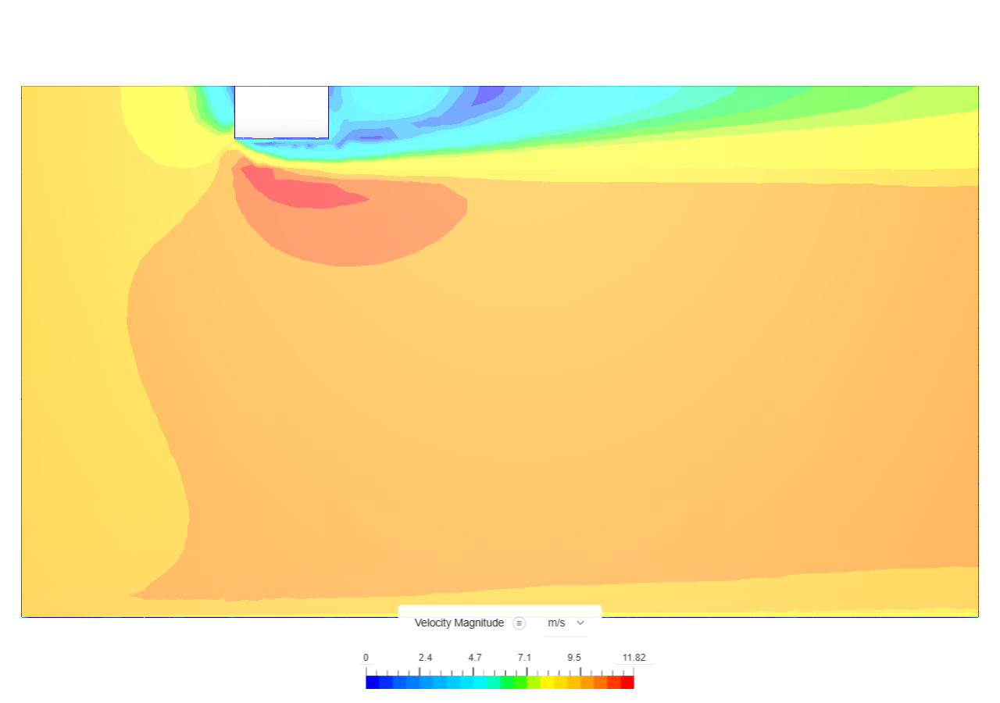
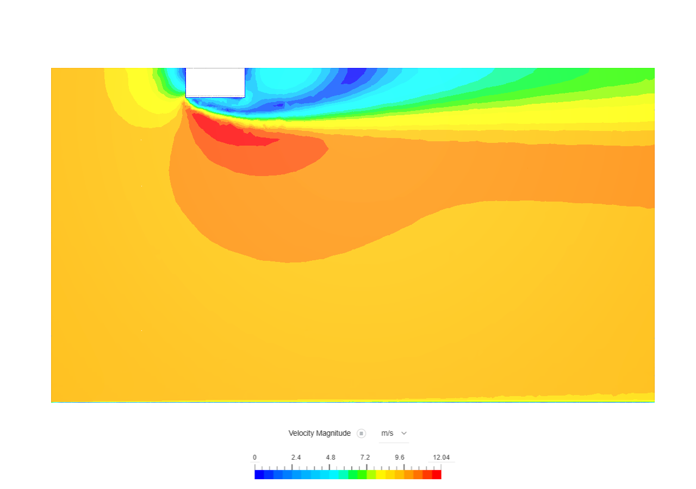

# Aerodynamics 101
Primera versión: octubre 14, 2026
Ultima actualización: octubre 14, 2026

Comparativa cuerpo circular vs cuadrangular (poligonal)
Se obtuvieron como resultados los siguientes contornos de presión y coeficientes de resistencia de avance
Hay una diferencia aprox. del 2% bajo las siguientes condiciones:
V= 10 m/s   Sref= 1m^2  rho= 1.965 kg/m^3
Perfil cuadrangular Cd= 0.309
Perfil circular Cd= 0.303

